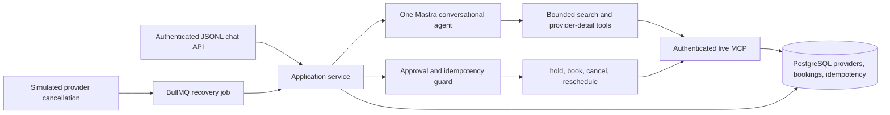

# Mastra errand agent build plan

This plan follows the three-page Orange engineering assignment and the eight tools in [db-mcp.yaml](../../db-mcp/db-mcp.yaml). The tools now read and write the backend's PostgreSQL provider, availability, and booking tables. The MCP `book` and `reschedule` tools retain the assignment's user-approved confirmation and confirmed-booking reschedule behavior. The existing Express booking APIs have a separate provider acceptance flow.

## Runtime shape

Keep Express as the API host and Mastra inside the Node service. The authenticated `POST /api/agent/chat` route streams JSONL and owns the session. One Mastra agent handles language understanding and provider comparison. It receives scoped provider reads, a booking list filtered to the signed-in customer, and preparation tools that create holds or pending proposals. Application code calls MCP write tools only after a second request to the same chat endpoint explicitly confirms a persisted proposal. The local MCP URL is `http://127.0.0.1:5002/mcp`; its proxy verifies the customer access token and binds the customer ID to booking tool calls.

## State and tool sequence

| Intent | Sequence | Required guard |
| --- | --- | --- |
| Find/book | Collect missing service, area, date/time, budget and preferences → search → compare 3–8 providers → select a slot → `hold_slot` → show **current quote** → await approval → `book` → verify | Approval binds user, provider, opaque slot, hold ID, quoted price and expiry. |
| Cancel | `list_bookings` for the authenticated user → show exact booking → await approval → `cancel` | Reuse the same idempotency key on the expected first 503 retry. |
| Reschedule | `list_bookings` → search available slots for the same provider → show exact new slot → await fresh approval → `reschedule` | A conflict returns to selection; any new slot requires another approval. Assignment reschedule applies to a **confirmed** booking. |
| Provider cancellation event | Consume a simulated event from BullMQ → verify affected booking → notify customer → search replacements within confirmed preferences → present options | Never rebook automatically; require fresh approval. |

Suggested states: `collecting`, `searching`, `comparing`, `holding`, `awaiting_approval`, `executing`, `verifying`, `completed`, `failed`, and `outcome_unknown`. Persist the state and selected provider/slot/quote after every transition. A correction changes only the affected field and invalidates a pending approval if a material detail changed. A ten-minute hold may expire while waiting; recheck it before booking.

Use a database approval row containing exact action details, expiry, and single-use state. The same chat endpoint accepts `{ "sessionId": "...", "approval": { "id": "...", "confirm": true } }`; it verifies the signed-in customer and stored proposal before `book`, `cancel`, or `reschedule`. Store one stable idempotency key per exact operation. On a `book` timeout, query `get_booking_status` by hold ID and key before retrying or claiming success. If the source of truth remains ambiguous, report that the outcome is unverified. MCP search returns opaque slot tokens; never construct a token from a date string.

## Files and interfaces

| Path | Responsibility |
| --- | --- |
| `prompts/errandAgent.md` | Customer conversation rules and treatment of untrusted tool text. |
| `agents/errandAgent.js` | Mastra `Agent` factory; accepts scoped tools and builds the `provider/model` ID from `LLM_PROVIDER` and `LLM_NAME`. |
| `mcp/assignmentClient.js`, `mcp/assignmentTools.js` | Request-scoped MCP client and adapter that discovers all eight live tools. |
| `agent-tools/errandTools.js` | Scoped read and preparation tools with MCP call budget and approval proposals. |
| `services/agentService.js` | Chat streaming, context compaction, approval execution and timeout recovery. |
| `models/agentSessionModel.js` | Session, message, summary, approval and booking ownership persistence. |
| `routes/agentRoutes.js` | One customer-only chat and approval endpoint. |
| `evals/` | Scripted-model scenario runner and generated results/trace artifacts. |

The chat, session, tool and approval files exist now. The offline eval runner covers current behavior; preference memory, crash recovery, and proactive cancellation still need implementation and evaluation. Configure `LLM_PROVIDER` (`anthropic`, `openai`, or `google`), `LLM_NAME`, `LLM_API_KEY`, and `MCP_URL`. The agent factory maps `LLM_API_KEY` to Mastra's provider-specific environment variable before constructing the model. Do not expose raw MCP write tools to the model. Set `LANGSMITH_TRACING=true`, `LANGSMITH_API_KEY`, and `LANGCHAIN_PROJECT` to export sanitized live traces.

## Context, memory, traces and evaluation

The current session store passes the full conversation while it has ten or fewer messages. Once it exceeds ten messages, it summarizes the older portion and sends the summary plus the latest ten. The summary and cursor are stored in PostgreSQL. Explicit preference facts with inspect/correct/forget actions, confirmed-only retrieval and a measured token cap remain to be built for the assignment's longer-term memory requirement.

Set initial ceilings of six model turns, ten MCP calls and 30 seconds per user request; enforce them outside the prompt with a final user-facing outcome on every exit. Mastra now exports sanitized model/tool spans to LangSmith and application spans record state transitions and direct MCP calls; `evals/results/example-trace.json` is a synthetic redacted trace. Token use and estimated cost are recorded when available. Approval tokens, MCP credentials, private contact data and full reviews stay out of exported traces. The timeout-after-success raw trace is still a separate deliverable.

The `npm run eval` suite generates 33 rows for implemented chat, search, approval, cancellation and rescheduling paths; see `evals/README.md` for the requirement-by-requirement coverage and limits. It includes fake-service restart, timeout-after-possible-request-commit and 50-fact compaction cases. Explicit preference inspection/correction/forgetting, proactive provider cancellation, a measured token budget, live-model injection checks and a real database restart/timeout trace remain to be built. The generated table belongs to the test run, not a hand-edited report. Then produce the remaining assignment artifacts: three real bugs with regression tests, timeout raw trace, demo, and assistant transcript.

## Build order

1. Verify the authenticated JSONL chat, MCP search, comparison and clarification against live PostgreSQL data.
2. Exercise the persisted approval and guarded write flow for booking timeouts, cancellation retries and rescheduling conflicts; add a durable operation ledger for crash recovery.
3. Add explicit preference APIs and measured context budget; then BullMQ cancellation-event recovery.
4. Add traces, offline eval harness and required assignment artifacts; run the full local demo against `db-mcp`.

Mastra references: [Agent and tool setup](https://mastra.ai/docs), [MCP client](https://mastra.ai/docs/connections/mcp), [workflows](https://mastra.ai/docs/workflows/control-flow), [memory](https://mastra.ai/docs/memory/overview), [observability](https://mastra.ai/docs/observability/overview).
