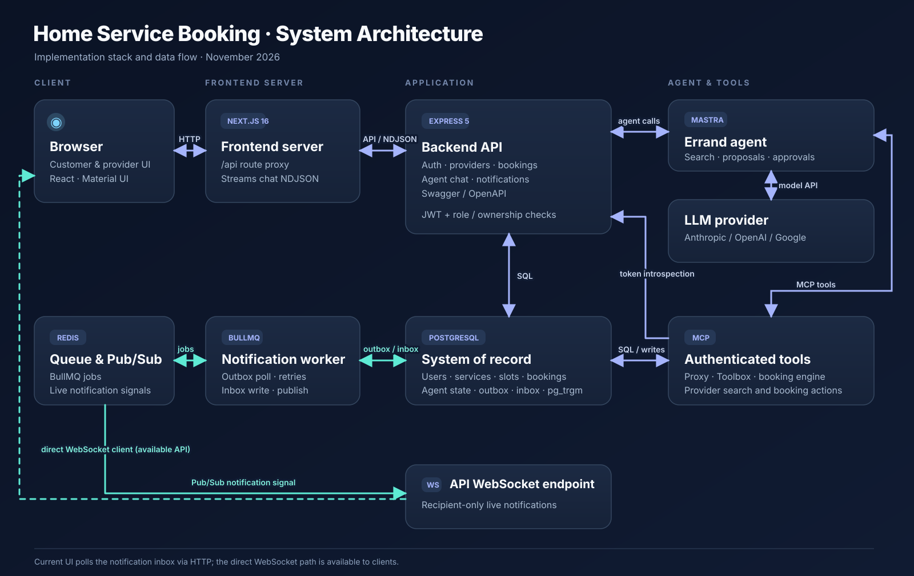

# Home Service Booking — System Design

This document describes the implementation in the `frontend`, `backend`, and `db-mcp` projects as of 10 November 2026. The diagram is an editable SVG, with a PNG copy for slides and reports.

[Download the PNG diagram](./system-architecture.png)

## Stack and responsibilities

| Layer | Technology | Responsibility |
| --- | --- | --- |
| Client | Next.js 16, React 19, Material UI | Customer chat and booking approvals, provider dashboard, login, and notification inbox. |
| Frontend server | Next.js API route | Forwards selected `/api/*` requests to the backend using `BACKEND_URL`; passes the chat NDJSON stream through. |
| Backend API | Node.js, Express 5, `ws` | Authentication, users, providers, services, availability, bookings, agent chat, notifications, and the WebSocket endpoint. Also serves OpenAPI and Swagger UI. |
| Agent | Mastra, selected LLM provider | Interprets service requests, searches providers, prepares approval proposals, and describes verified outcomes. Configured with Anthropic, OpenAI, or Google through `LLM_PROVIDER`, `LLM_NAME`, and `LLM_API_KEY`. |
| Tool service | Authenticated MCP proxy, MCP Toolbox, Node booking engine | Exposes provider search and booking tools. Its proxy validates the customer token with the backend and binds the customer ID to tool calls. The Toolbox and booking engine use the same PostgreSQL database as Express. |
| System of record | PostgreSQL, `pg` pool, `pg_trgm` | Users, provider listings, services, availability, bookings, agent sessions and approvals, notification outbox and inbox. SQL triggers and guards enforce booking transitions and overlap rules. `pg_trgm` supports fuzzy area search. |
| Async delivery | BullMQ worker and Redis | Worker polls PostgreSQL outbox, queues delivery jobs in Redis, writes in-app notifications to PostgreSQL, and publishes live signals. API instances subscribe to Redis Pub/Sub for WebSocket delivery. |

## Why these technologies

| Technology | Reason for choosing it |
| --- | --- |
| Express.js | Mastra runs in the Node.js backend, so Express lets the team integrate the agent with existing HTTP routes quickly. Its simple middleware model and broad npm library ecosystem support faster development. |
| Next.js | Built-in routing, API routes, and rendering features speed up frontend development. The client and server boundaries make it clear where UI side effects run, while the API route centralizes backend mutations and forwards the streaming chat response. |
| Material UI (MUI) | Shared components and theme conventions keep the customer and provider interfaces visually consistent. |
| Mastra | Provides the agent, tool, model, and streaming primitives needed for the errand assistant. The implementation also uses it for conversation summarization and action narration. |
| MCP Toolbox | Defines database-backed search tools and booking tool endpoints through MCP. The separate authenticated proxy validates tokens, scopes customer calls, and keeps the internal Toolbox endpoint private. |
| PostgreSQL | A single broadly supported database holds transactional booking data, agent state, and notification records, keeping the deployment straightforward. SQL constraints and triggers protect booking correctness; `pg_trgm` enables typo-tolerant area search. The current search does not use pgvector. |

## Connections

1. The browser calls the Next.js `/api/*` route over HTTP. The route forwards allowed requests to Express with the bearer token. Chat responses stream back as newline-delimited JSON (NDJSON).
2. Express checks the signed JWT and current account state, applies role and ownership rules, and reads or writes PostgreSQL through its `pg` pool.
3. For customer chat, Express runs the Mastra agent. The agent calls the configured LLM and scoped tools. Tool calls go to the authenticated MCP endpoint; MCP checks the token through Express `/api/auth/introspect` and queries or updates the same PostgreSQL data.
4. Booking requests and provider decisions create an outbox event in the same database transaction. The separate worker polls the outbox, adds BullMQ jobs to Redis, and saves each recipient's notification in PostgreSQL. Redis Pub/Sub carries live signals to the API WebSocket handler.
5. The current Next.js notification bell polls `GET /api/notifications` about every 20 seconds and on focus. Express also offers `/api/notifications/ws` for direct, authenticated WebSocket clients; the current frontend does not use that socket.

## Main booking sequence

1. A provider creates an active service and a service-specific availability window.
2. A customer requests a booking directly or asks the agent to find one. MCP search uses provider, service, slot, and review data and proposes starts that fit the service duration.
3. A direct request creates a ten-minute `held` booking and submits it to the provider. An agent-created hold stays private until the customer confirms the exact proposal in a second chat request. The proposal and approval are stored in PostgreSQL.
4. Only the provider owner can accept or reject a submitted hold. Acceptance changes it to `confirmed`; rejection frees the time. PostgreSQL guards reject invalid transitions and overlapping active holds or confirmed bookings.
5. A rejected direct booking can be held again through the customer reschedule route. Moving a confirmed booking through the agent creates a provider reschedule request that the provider must decide.

## Deployment and boundaries

Run the frontend, Express API, notification worker, and MCP service as separate processes. They share PostgreSQL; the API and worker also use Redis. The MCP service's internal Toolbox and booking engine listen on loopback, behind its authenticated proxy. In local development the backend defaults to port `8000` and MCP to `127.0.0.1:5002/mcp`.

The diagram shows application components present in the repository. CDN, load balancer, sharding, replicas, and backup infrastructure from the reference image are deployment options, but are not specified by this implementation.

## Implementation references

- Frontend proxy: `../frontend/app/api/[...path]/route.ts`
- API entry point and WebSocket attachment: `app.js`, `realtime/notificationSocket.js`
- Agent and MCP client: `services/agentService.js`, `mcp/assignmentClient.js`
- MCP proxy and tools: `../db-mcp/authProxy.mjs`, `../db-mcp/db-mcp.yaml`
- Notification worker: `jobs/notificationWorker.js`
- Database schema and guards: `migration/002_create_provider_tables.sql`, `migration/003_create_provider_guards.sql`, `migration/004_create_bookings.sql`, `migration/005_create_notifications.sql`, `migration/006_create_agent_sessions.sql`, `migration/007_create_mcp_booking_operations.sql`, `migration/008_create_booking_requests.sql`, `migration/009_create_reschedule_requests.sql`
